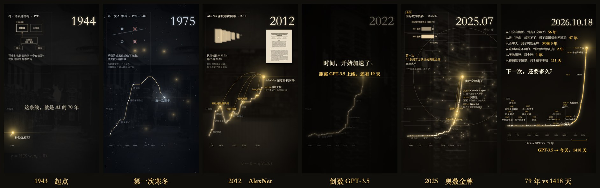
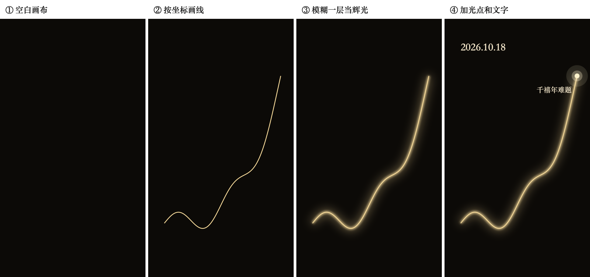
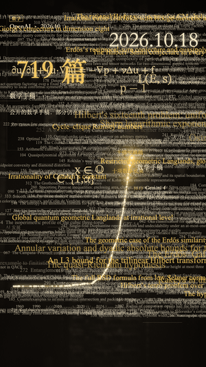
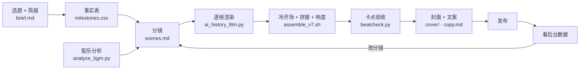

<div align="center">

# video-claude

**用代码做科普视频**

从事实核查、逐帧渲染、卡点，到封面和发布文案，每一步都是代码或纯文本，可以复现，也可以改了拿去用。




</div>

## 两期视频

<table>
<tr>
<td width="50%" align="center" valign="top">
<br>
<b>第一期：AlphaGo 第 37 手，它在想什么？</b><br>
蒙特卡洛树搜索讲给不懂围棋的人<br>
<sub>Manim · B站 16:9 7:27 · 竖版 1:46</sub>
</td>
<td width="50%" align="center" valign="top">
<br>
<b>第二期：AI 发展路线图</b><br>
一条会发光的线，从 1943 年走到 2026-10-18<br>
<sub>自写逐帧渲染器 · 竖版 5:16 · B站横版 · 抖音 3:20 剪辑版</sub>
</td>
</tr>
</table>

成片不在仓库里：单个约 120 MB，而且压进了有版权的配乐和新闻图片。

<!-- 抖音 / B站 发布链接：待补 -->

## 一帧画面是怎么画出来的

第二期没用剪辑软件，也没用 Manim。整条片子是一个函数 `render_frame(t)`：给它一个时间，它算出那一刻所有东西的位置，画成一张 1080×1920 的图。每秒 30 张，约 9400 张，8 个进程并行画，像素直接管道给 ffmpeg 编码。



想上手，直接跑 [`tools/minimal_film.py`](tools/minimal_film.py)：80 行，画出一条从 1943 年长到 2026 年的发光线。核心就这几行：

```python
def render_frame(t, dur):
    p = min(1.0, t / (dur * 0.85))                             # 线长到哪了
    s = cairo.ImageSurface(cairo.FORMAT_ARGB32, W, H)
    c = cairo.Context(s)
    c.set_source_rgb(0.05, 0.04, 0.03); c.paint()             # 1. 空白画布
    pts = points(p)
    c.set_source_surface(glow_layer(pts)); c.paint()           # 2. 辉光：粗线缩小画、高斯模糊、放大垫底
    c.set_source_rgb(*GOLD); c.set_line_width(2.5)             # 3. 线本身，cairo 负责抗锯齿
    c.move_to(*pts[0])
    for q in pts[1:]:
        c.line_to(*q)
    c.stroke()
    ...                                                        # 4. 线头光点、年份文字
    return s                                                   # → BGRA 字节 → ffmpeg libx264
```

## 画面里的每样东西

<table>
<tr>
<td width="42%" valign="top"></td>
<td valign="top">

| # | 元素 | 怎么做的 |
|---|---|---|
| 1 | 信息窗 | 每个节点一个窗口：类别、标题、小动画或对比条形图、白话解释、背景故事。窗口在重拍上打开，节点到达时缩小飞进线头 |
| 2 | 时钟 | 视频时间经 PCHIP 插值换算成故事里的日期。越往后单位越细：年 → 月 → 日 |
| 3 | 配图 | 论文首页（PDF 截页）、维基共享资源图片、新闻图。没有新图时保留上一张，不黑屏 |
| 4 | 线头 | 大突破时光粒从线头炸开，粒子数和冲击环大小跟节点的分量 `major` 走：Transformer 120，千禧年难题 250 |
| 5 | 回声 | 新节点建立在旧节点上时（`builds_on.csv`），旧点重新亮起，光粒沿贝塞尔弧飞过来 |
| 6 | 小条 | 较小的进展：日期 + 名字 + 一句话 + 标签（超越人类 / 论文 / 新闻），落在半拍上 |
| 7 | 时间轴 | 对数压缩，`u = log(1 + (今天 − t) / c)`，过去被挤到左边 |
| 8 | 背景公式 | 每个时代一条经典公式，低透明度，用 STIX Two Math 排上下标 |

</td>
</tr>
</table>

<table>
<tr>
<td width="34%" valign="top"></td>
<td valign="top">

**片尾**：719 篇数学手稿堆满屏幕，线头冲出来；镜头拉远看整条线，「1943 → GPT-3.5：79 年」和「GPT-3.5 → 今天：1418 天」放在一起，再一行行列出「从……到……」用了多久。

每一行都落在音乐的拍子上。

</td>
</tr>
</table>

## 流水线



## 技术栈

| 环节 | 用什么 | 说明 |
|---|---|---|
| 画面 | [pycairo](https://pycairo.readthedocs.io/) | 线、圆、文字，矢量绘制、抗锯齿 |
| 辉光、模糊 | numpy + scipy | `gaussian_filter`，在 1/3 分辨率上算再放大，快很多 |
| 图片 | Pillow | 缩放、调色、贴图 |
| 编码 | ffmpeg（libx264, crf 18） | 原始 BGRA 帧走管道，8 段并行后 concat |
| 动画（第一期） | [Manim Community](https://www.manim.community/) | 树搜索、棋盘、柱状图 |
| 节拍分析 | numpy + scipy 自己写 | 频谱通量 → 自相关测速 → 动态规划追拍（Ellis 2007） |
| 音效 | numpy 合成 | 正弦波 + 带种子的噪声，无版权 |
| 响度 | ffmpeg `loudnorm` / `ebur128` | 平台成片 −14 LUFS，真峰值 −1.5 dBTP |
| 封面 | HTML + headless Chrome（第一期）；渲染器总览帧（第二期） | 首帧和封面一致 |
| 论文页 | macOS PDFKit（Swift） | arXiv PDF 截某一页 |
| 图片来源 | Wikimedia API | 拿真实地址和授权，记进 `LICENSES.md` |
| 字体 | 宋体 Songti SC、Times New Roman、STIX Two Math | macOS 自带 |
| 写代码、渲染、自查 | [Claude Code](https://claude.com/product/claude-code) | 抽帧看图、跑断言、量响度和卡点 |
| 文案初稿、交叉核查 | Pi 调多个模型（Kimi、Grok、GPT） | 输出只当线索，事实都回到原始来源确认 |

## 可以直接拿去用的工具

| 文件 | 干什么 | 用法 |
|---|---|---|
| [`tools/minimal_film.py`](tools/minimal_film.py) | 80 行的逐帧渲染模板 | `python tools/minimal_film.py out.mp4` |
| [`manim/sfx/analyze_bgm.py`](manim/sfx/analyze_bgm.py) | 节拍、小节、段落表（卡点用） | `python analyze_bgm.py song.mp3 --bpm-hint 90` |
| [`manim/scenes/beatcheck.py`](manim/scenes/beatcheck.py) | 量画面跳变离最近的拍子差几毫秒 | `python beatcheck.py film.mp4 --cold 3.8667 --body-from 1.366667` |
| [`manim/scenes/coldopen.py`](manim/scenes/coldopen.py) | 一小节冷开场：首帧 = 封面，每拍推一下，在重拍上硬切 | `python coldopen.py cover.jpg 1080 1920 out.mkv` |
| [`manim/sfx/make_sfx.py`](manim/sfx/make_sfx.py) | 合成 16 种无版权音效 | `python manim/sfx/make_sfx.py` |
| [`manim/sfx/master_audio.py`](manim/sfx/master_audio.py) | 压缩 + 响度 + 限幅，前后数字都打印出来 | `python master_audio.py in.mp4 out.mp4 --target -24` |
| [`tools/wiki_image.py`](tools/wiki_image.py) | 查维基图片的真实地址、尺寸、授权、作者 | `python tools/wiki_image.py "File:Eniac.jpg"` |
| [`tools/pdfpage.swift`](tools/pdfpage.swift) | PDF 某一页 → PNG（macOS） | `swift tools/pdfpage.swift paper.pdf 0 p1.png 1600` |
| [`docs/make_img.py`](docs/make_img.py) | 从渲染器直接出 README 里的这些图 | `python docs/make_img.py` |

每个工具的原理、参数和踩过的坑写在 **[方法与工具.md](方法与工具.md)**；选题、讲法、字幕、封面、文案的经验写在 **[爆款科普视频手册.md](爆款科普视频手册.md)**。

## 几条最有用的做法

- **时间是唯一输入**：画面是 `render_frame(t)` 的纯函数，所以任何一秒都能单独抽出来看（`snap`），可以切段并行渲染，横版竖版也共用一套时间线。
- **先建事实表，再写画面**：253 个节点，每行有出处链接、可信度和「措辞备注」（能说什么、不能说什么）。模型核查只当线索，2025 年以后的事实它们经常编。
- **卡点要量出来**：节拍表 → 窗口打开对齐整拍、小条对齐半拍 → `beatcheck.py` 验收。第一次量只有 11% 在一帧以内，原因是剪辑点不在帧边界上；改完之后是 90%，中位误差 17 ms。
- **首帧就是封面**：v7 加了一小节冷开场，第一帧和封面一模一样。
- **发出去再改一版**：v7 在 ChatGPT 之前的空档补了小条，第一次寒冬剪掉 4 小节音乐，抖音另出一个 3 分钟版。
- **一份代码出两种画幅**：所有位置写在 `LAYOUT` 字典里，加横版后先确认竖版逐像素没变。

## 自己跑起来

环境：Python 3.12 + `pycairo numpy scipy Pillow`（第一期还要 `manim`），命令行里有 `ffmpeg`。字体用 macOS 自带的。

```bash
pip install pycairo numpy scipy pillow
python tools/minimal_film.py demo.mp4          # 先跑通最小示例
```

第二期（在 `manim/scenes` 下）：

```bash
python ai_history_film.py check                                   # 核对数据和时间轴
python ai_history_film.py snap 20 140 214 300                     # 抽几帧，出联系表
python ai_history_film.py render 0 313.09 --jobs 8 --name ai_history_v7_body
AIH_ORIENT=landscape python ai_history_film.py render 0 313.09 --jobs 8 --name ai_history_v7_bili_body
PY=python sh assemble_v7.sh                                       # 冷开场 + 拼接 + 响度，出三个成片
python beatcheck.py ../../ai_history/film_out/ai_history_v7.mp4 --cold 3.8667 --body-from 1.366667
```

渲染前要补齐仓库里没有的素材：

- **图片**：按 [`ai_history/images/LICENSES.md`](ai_history/images/LICENSES.md) 的来源下载，放进 `ai_history/images/`。
- **配乐**：放进 `ai_history/bgm/`，文件名见渲染器里的 `BGM_FILE`；节拍表用 `analyze_bgm.py` 生成。
- **音效**：`python manim/sfx/make_sfx.py` 重新生成。

第一期：

```bash
manim -qh --disable_caching manim/scenes/alphago_mcts.py AlphaGoMCTS               # 16:9
manim -r 1080,1920 --disable_caching manim/scenes/alphago_mcts.py AlphaGoMCTSShort  # 竖版
python manim/sfx/master_audio.py 原片.mp4 成片.mp4 --target -24 --peak -1.5
```

## 目录

```
├── 方法与工具.md                 每个工具的原理、参数、踩过的坑
├── 爆款科普视频手册.md            选题、讲法、字幕、封面、文案的经验
├── tools/                        通用小工具
│   ├── minimal_film.py           80 行逐帧渲染模板
│   ├── wiki_image.py             维基图片：真实地址 + 授权
│   └── pdfpage.swift             PDF 页 → PNG
├── manim/
│   ├── scenes/
│   │   ├── ai_history_film.py    第二期渲染器（竖版 / 横版同一份代码）
│   │   ├── coldopen.py           冷开场
│   │   ├── assemble_v7.sh        拼接三个成片
│   │   ├── beatcheck.py          卡点验收
│   │   ├── ai_history.scenes.md  第二期分镜与修订记录（最新在前）
│   │   ├── alphago_mcts.py       第一期 Manim 代码
│   │   └── style.py              配色、字体、阅读时间
│   └── sfx/                      音效合成、母带、节拍分析
├── ai_history/                   第二期资料
│   ├── milestones.csv            253 个核实过的节点（日期、出处、措辞备注）
│   ├── builds_on.csv             节点之间的前置关系（带证据）
│   ├── quotes.csv                核实过的原话和背景故事
│   ├── images.md, images/LICENSES.md  每张图的来源与授权（图片本身不在仓库）
│   ├── copy.md                   抖音、B站的标题、简介、章节、置顶评论
│   └── cover/                    封面
├── alphago/                      第一期封面源文件、截图、发布文案
└── docs/                         README 配图和生成脚本
```

## 许可

- 代码、我们自己写的文档和数据：MIT（见 [`LICENSE`](LICENSE)）。
- 不包括第三方素材：
  - 图片和配乐不在仓库里，版权归原作者。
  - `openai_math_families.json` 来自 [openai/math](https://github.com/openai/math)，遵循 Apache-2.0。
  - 引用的原话和论文标题都注明了出处。
