# 风格库

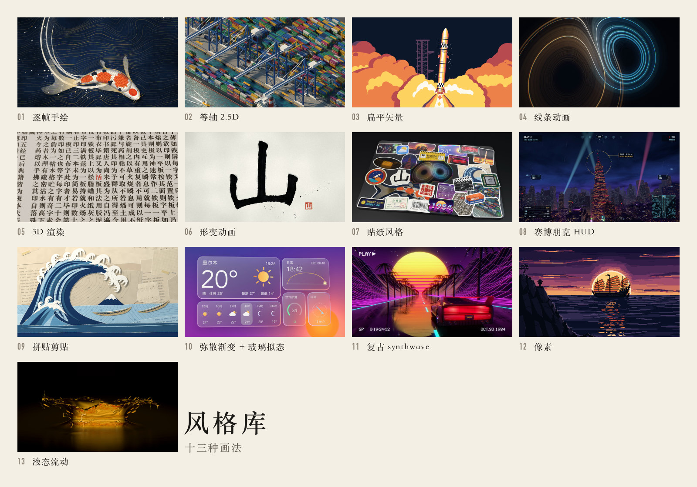

做片子可以挑的 13 种画面风格。每种列出识别特征、做法、适合的内容和踩过的坑；每种另配一张样片图，主题写在各节的「样片」一行。

样片都由代码生成。选题先定一句话主线，再挑能让陌生人一眼认出主题的风格。

通用规矩，每种风格都适用：

- **每期一个新世界**：主风格不和上一期重复。
- **一秒认出主题**：陌生人要能马上说出画的是什么，抽象图形不行。
- **不画卡通人和机器人**：主角用物件、界面和光来演。
- **字做得像真东西**：压制车牌、楼体媒体立面。灯箱字、通用无衬线、字幕条都显廉价，放大看更明显。
- **片子要有弧线**：末帧不同于首帧，不做无限循环。
- **物理道具用真 3D**：Blender 建模渲染，不用 2D 假 3D。

## 怎么选

| 内容类型 | 推荐风格 | 理由 |
|---|---|---|
| 科技 | 赛博朋克 HUD、扁平矢量 | HUD 表现城市科技，扁平风格解释原理。 |
| 历史人文 | 拼贴剪贴、逐帧手绘 | 拼贴适合史料，手绘适合叙事和情绪。 |
| 经济数据 | 等轴 2.5D、线条动画 | 等轴呈现系统规模，线条呈现轨迹关系。 |
| 艺术 | 形变动画、液态流动 | 形变演绎意象转换，液态呈现形态变化。 |
| 产品 | 3D 渲染、弥散渐变 + 玻璃拟态 | 3D 展示真实物件，玻璃拟态适合界面。 |

## 总表

| 风格 | 一眼认出 | 适合讲 | 主要工具 | 渲染成本 | 用过 |
|---|---|---|---|---|---|
| 逐帧手绘 | 线条每隔几帧重画一次，微微抖动；纸面质感 | 故事、历史、情绪 | cairo（带种子的路径扰动） | 纯 2D，不需要 GPU | — |
| 等轴 2.5D | 没有透视的小方块世界，地面线斜 30° | 系统、流程、规模（工厂、数据中心、交易所） | cairo 等轴投影；Blender 正交相机 | — | — |
| 扁平矢量 | 纯色块、几何形，只有少量渐变和光 | 概念解释、信息图 | cairo；Manim | 纯 2D，不需要 GPU | 第一期 |
| 线条动画 | 描边从无到有地长出来，常带辉光 | 时间线、轨迹、电路、关系 | cairo | 纯 2D，不需要 GPU | 第二期（深底金线） |
| 3D 渲染 | 真实材质、光影、景深 | 真实物件、尺度对比 | Blender Cycles（Studio） | — | 第三期（搁置） |
| 形变动画 | 一个形状连续变成另一个 | 「A 其实就是 B」、概念转换 | cairo 路径插值；Blender 形态键 | 纯 2D，不需要 GPU | — |
| 贴纸风格 | 白边、投影、歪一点、弹出来 | 梗、吐槽、快节奏 | cairo；Blender Cycles | — | 第四期（表情包） |
| 赛博朋克 HUD | 深底网格、霓虹色、面板角标、扫描线、故障 | 科技、金融、黑客、AI | cairo；Blender Cycles | Blender Cycles：M5 Max 单任务约 30 秒/帧 | 第四期（深蓝 + 青 / 琥珀） |
| 拼贴剪贴 | 剪报、撕边、胶带、半调网点、定格抖动 | 历史事件、新闻、社会议题 | cairo + 图片 | — | — |
| 弥散渐变 + 玻璃拟态 | 柔和的大色团渐变，上面是半透明毛玻璃卡片 | 产品、AI 助手、轻科普 | cairo + numpy 模糊；Blender Cycles | — | — |
| 复古 synthwave | 条纹落日、霓虹、透视网格地面、铬字、VHS 噪点 | 怀旧、计算机史、游戏 | cairo；Blender Cycles | Blender Cycles：M5 Max 单任务约 18 秒/帧 | — |
| 像素 | 低分辨率方格、有限调色板、整数倍放大 | 早期计算机、游戏、「图像就是一格格数字」 | cairo 小画布 + 最近邻放大 | 纯 2D，不需要 GPU | — |
| 液态流动 | 黏稠地融合、分裂、流淌，金属液或彩色流体 | 资金流、数据流、扩散、渐变过程 | 2D 用 metaball 场；3D 用 Blender 流体（Studio） | — | — |

## 逐帧手绘

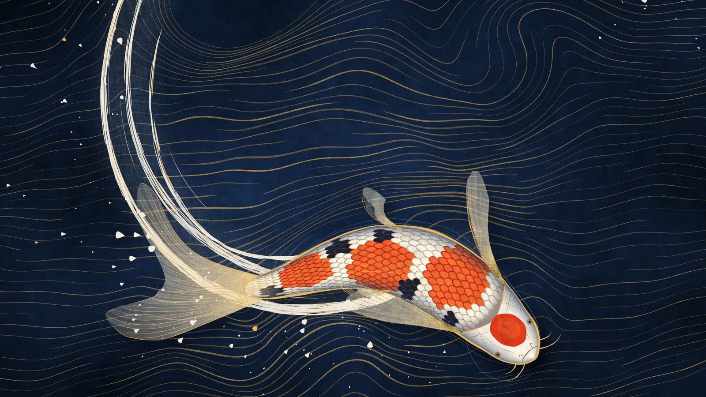

- **样片**：手绘锦鲤（鳞片金线、摆尾水花环）
- **特征**：
  - 线条会「沸腾」：同一根线每 2–3 帧重画一次，抖动的样子都不一样。
  - 有 12–15 fps 的手作节奏感，叠纸张纹理，笔触宽窄有变化。
- **做法**：
  - 路径按弧长重采样，沿法向加一点噪声，噪声种子取 `帧号 // 2`。
  - 笔触用变宽的多边形画，或者用几条半透明细线叠出来。
  - 最底下垫一张纸纹。
- **适合**：用物件讲故事、历史和情绪；别用来表现需要精确几何或写实物理的内容。
- **踩过的坑**：鳍条按实际距离弯曲才不互穿，鳞片要裁在身体内。

## 等轴 2.5D

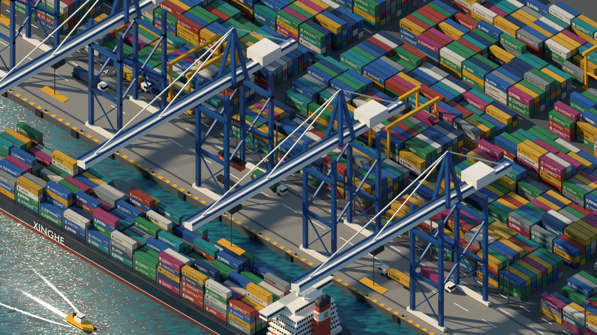

- **样片**：等轴港口（集装箱港口）
- **角度**：
  - 真等轴：三根轴两两成 120°，地面线和水平线成 30°。
  - 像素游戏常用 2:1 的斜率（约 26.57°），这样线条能对齐整像素。
- **cairo 做法**：
  - 投影公式：`(x, y, z) → ((x − y)·cos30°, (x + y)·sin30° − z)`。
  - 立体感靠三档明暗：顶面亮、左面中、右面暗。
- **Blender 做法**：正交相机，X 轴转 54.736°（arctan √2），Z 轴转 45°。
- **适合**：讲清系统、流程和规模；别用来表现需要透视纵深或细腻写实的场景。

## 扁平矢量

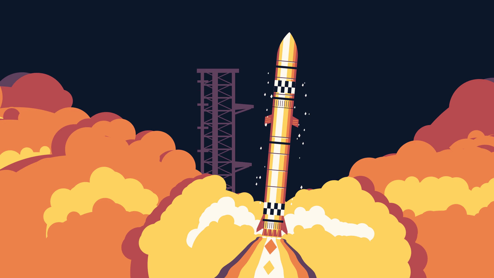

- **样片**：扁平火箭入轨
- **特征**：
  - 4–6 色的限定调色板，形状几何化。
  - 描边要么没有，要么全片统一粗细。
  - Kurzgesagt 那种风格是在扁平上加少量渐变和光晕。
- **做法**：cairo 和 Manim 都能直接画，技术上没有难点，难在配色和留白。
- **适合**：解释概念、原理和流程；别用来表现需要真实材质和物理质感的物件。
- **踩过的坑**：Droste 无限循环被否，云和大气边缘要两端收尖。

## 线条动画

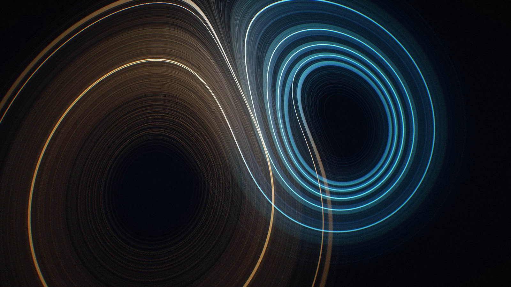

- **样片**：洛伦兹吸引子（线条）
- **做法**：
  - 按弧长截取路径，让描边一点点长出来，再加辉光。第二期的 `render_frame` + `glow_layer` 就是这样做的。
  - 变体：电路走线、地图航线、一笔画、手写字逐笔出现。
- **适合**：表现轨迹、时间线、电路和关系；别用来替代需要可辨认实体的画面。
- **踩过的坑**：虚焦处亮珠会形成念珠和摩尔纹，要提前淡出。

## 3D 渲染

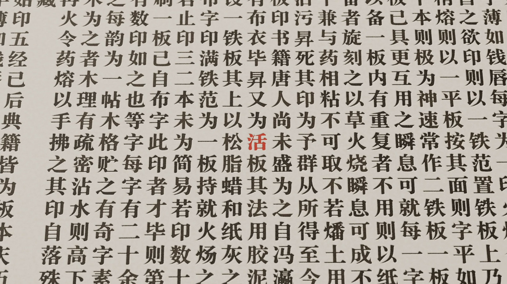

- **样片**：活字印刷（3D 渲染）
- **环境**：
  - Blender 5.2 装在 Studio 的 `~/opt/blender`，Cycles 能用上 40 核的 Metal GPU。
  - 场景用脚本搭，不提交 .blend。
  - 时间轴由片子脚本说了算：它导出逐帧状态 JSON 给 Blender；字幕和文字回到 cairo 里叠。
- **适合**：观众认识的真实物件（麦粒、棋盘、篮筐、芯片、铅字），以及尺度对比；别用来表现纯抽象关系或不需要真实材质的内容。
- **踩过的坑**：白页停留太久像死帧，要压缩。Bullet 模拟要放大 100 倍。宋体显示繁体字会变豆腐块。

## 形变动画

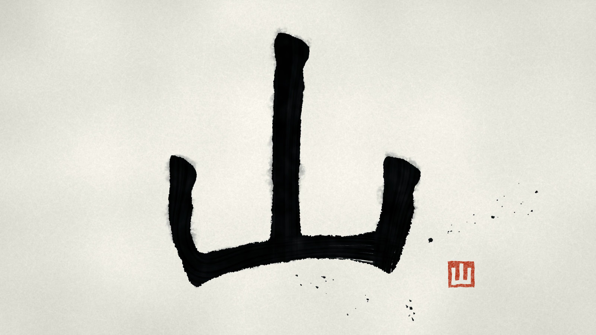

- **样片**：水墨山变「山」字
- **做法**：
  - 两个形状各按弧长重采样到同样的点数，对齐起点和绕向，再逐点插值。
  - 带洞的轮廓（比如字形）要一段对一段地配对，配不上的那段缩成一个点。
  - 文字：用 cairo 的 `text_path` + `copy_path_flat` 拿到轮廓。
  - 3D：Blender 形态键，要求两个形状顶点数一致。
- **适合**：讲概念转换和因果变化；别用来表现没有明确起点、终点的内容。

## 贴纸风格

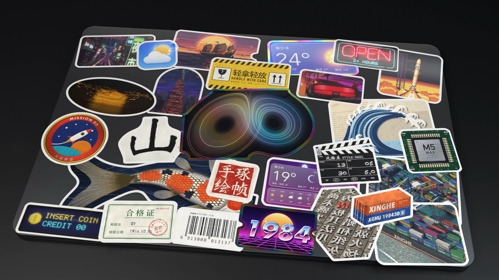

- **样片**：笔记本盖板贴满 27 张可辨认的贴纸
- **做法**：
  - 白描边：把 alpha 通道膨胀 8–12 px。
  - 柔投影，随机歪一个小角度。
  - 弹出时带过冲（第四期的 `pop`），偶尔做一个卷边。
  - 第四期 kit 里有现成的 `sticker()`。
- **适合**：讲梗、吐槽和快节奏内容；别用抽象图案充当主体贴纸。
- **踩过的坑**：抽象贴纸认不出来，裁切要选有主体的帧；光带扫过会把贴纸冲白。

## 赛博朋克 HUD

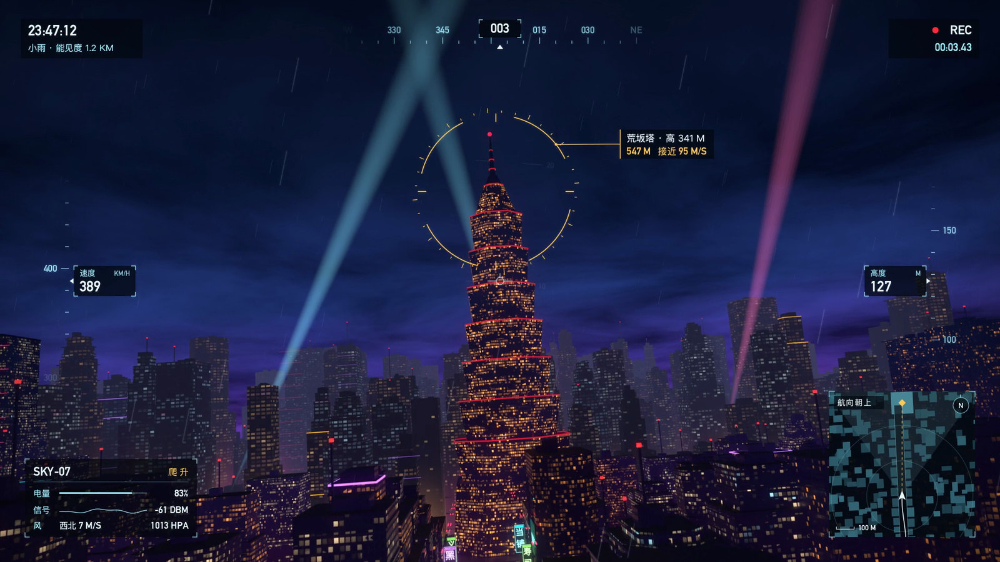

- **样片**：雨夜无人机穿城锁定荒坂塔
- **特征**：深底网格、青 / 品红 / 琥珀霓虹、面板角标、等宽数字跳动、扫描线、色差（RGB 分离）、故障切片。
- **现成工具**：第四期 kit 里的 `panel`、`gline`、`glow_text`、`num` 和背景网格。
- **适合**：讲城市科技、金融、黑客和 AI；别用来讲需要明亮、安静界面的内容。
- **踩过的坑**：窗格太大显玩具，雨太粗太密会切断远景；横幅不要黑底白字；楼上大字容易廉价，地标靠灯光和轮廓辨认。

## 拼贴剪贴

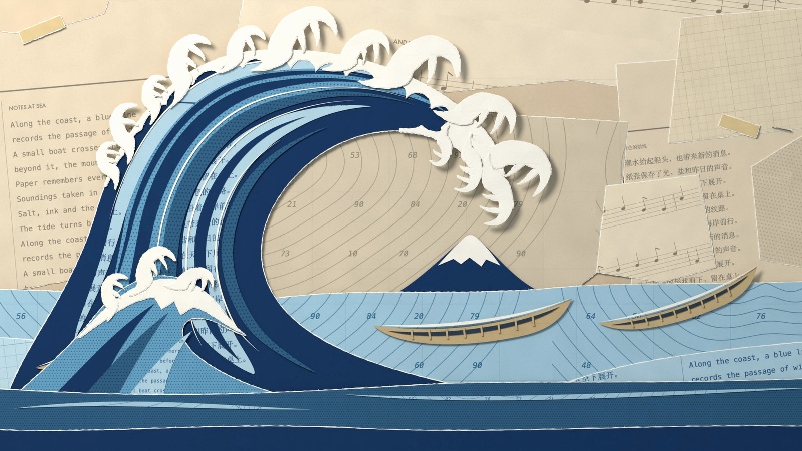

- **样片**：剪纸版北斋巨浪
- **做法**：
  - 剪报和照片按不规则多边形剪下来。
  - 撕边：边缘加噪声，再留一圈纸纤维白边。
  - 加胶带条和一层半调网点。
  - 字体混排：报纸宋体配粗黑体。
  - 定格抖动：每 3 帧换一次微小的位移和旋转。
- **素材**：维基共享资源的公有领域图片（用 `tools/wiki_image.py` 查授权），加自己拍的纸张纹理。
- **适合**：讲历史事件、新闻和社会议题；别用来讲需要连续、精确空间关系的内容。

## 弥散渐变 + 玻璃拟态

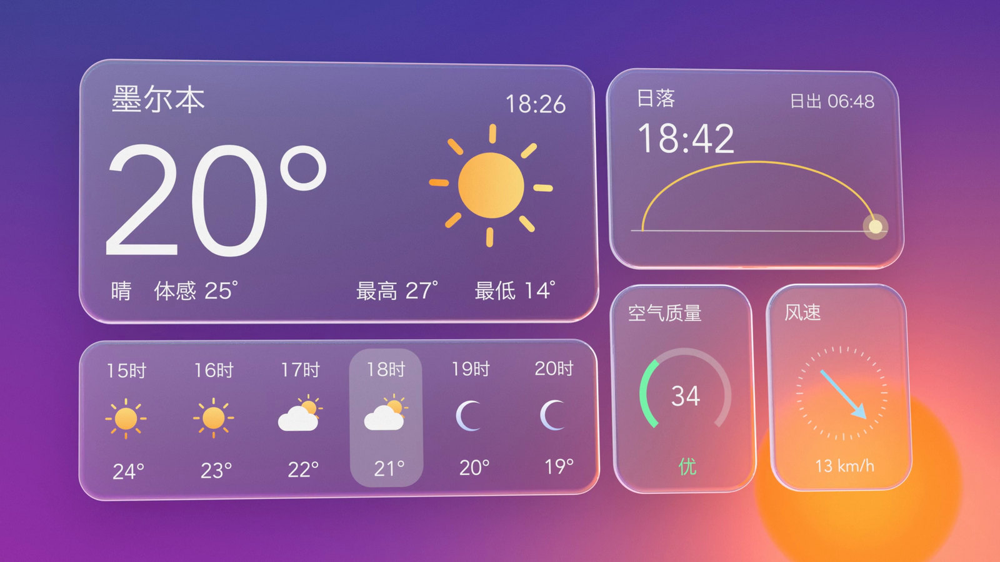

- **样片**：玻璃拟态天气 App 昼夜
- **背景**：3–5 个大色团，用上百像素的半径做高斯模糊，让它们慢慢漂移，形成柔和的网格渐变。
- **玻璃卡片**：
  - 把卡片下面那块背景再模糊一次（半径 20–40 px），填进卡片。
  - 叠 10–20% 的白，加一条 1 px 的半透明白高光边和柔阴影。
- **实现**：numpy 只对卡片区域做模糊。
- **适合**：展示产品界面、天气和轻科普；别用来表现需要粗粝、强烈质感的主题。
- **踩过的坑**：月亮过早出现会穿帮，要等到后段才淡入。

## 复古 synthwave

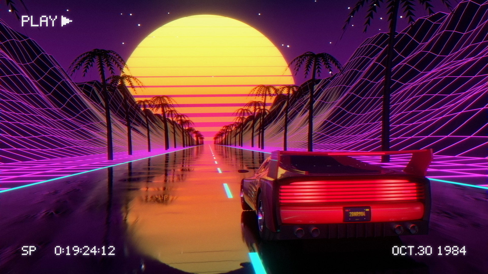

- **样片**：红色跑车与红金落日（synthwave）
- **特征**：
  - 地平线上一轮条纹落日，越往下条纹越粗。
  - 天空从紫、粉渐变到橙，透视网格地面朝镜头滚动。
  - 铬金属字、远山线框、扫描线、VHS 偏色噪点。
- **做法**：cairo 就够；想要铬字和地形有真实反射，就上 Blender。
- **适合**：讲怀旧、计算机史和游戏；别用来表现不适合霓虹夜景的题材。
- **踩过的坑**：车身用截面放样加折痕，平板会像鞋盒；镜面路上点光源会变成球，要关 `visible_glossy`，柔光箱用灯光链接；时间码要算成合法的秒和帧，别露馅；太阳必须是红金，不能黑。

## 像素

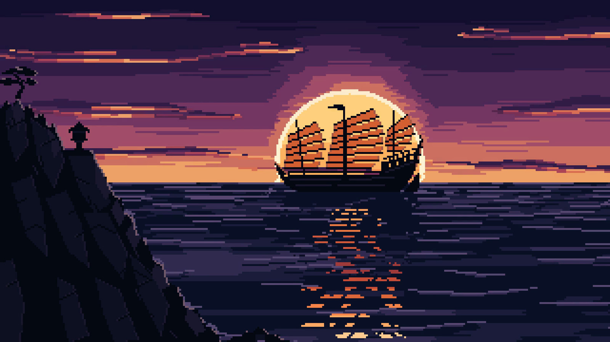

- **样片**：落日戎克船（像素）
- **做法**：
  - 画到小画布上，关掉抗锯齿（cairo 的 `ANTIALIAS_NONE`）。
  - 用最近邻插值按整数倍放大：横版 320×180 放大 6 倍，竖版 270×480 放大 4 倍。
  - 用 16–32 色的限定调色板；动画 8–12 fps 换一帧，物体按整像素移动。
- **适合**：早期计算机、游戏、「一张图其实是一格格数字」（讲图像生成、压缩时特别直观）。
- **踩过的坑**：太阳要干净的圆，反光用断续横线，船要能认出型号。

## 液态流动

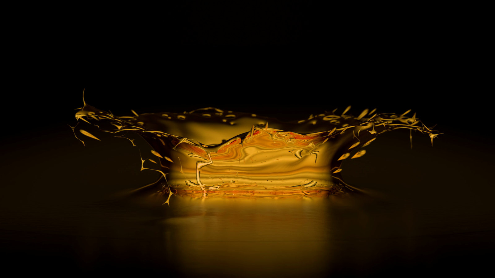

- **样片**：金色液态水冠
- **2D 做法**：
  - metaball：每个球给周围贡献 `r²/d²`，场值超过阈值的地方就是「液体」。
  - 阈值边缘做平滑，再加高光。融合和分裂天然好看，cairo + numpy 就够。
- **3D 做法**：
  - Blender 液体模拟（Mantaflow），金属或彩色液体的材质用 Cycles 渲。
  - 模拟和渲染都在 Studio 完成。
- **适合**：表现资金流、数据流、扩散和渐变过程；别用来表现需要清楚结构、棱角的产品。
- **踩过的坑**：新场景不能回放 Mantaflow 烘焙，要直接读 `mesh/fluid_mesh_NNNN.bobj.gz`。

## 候选选题怎么配

一期一个主风格，可以借一种做点缀（比如第四期主体是 HUD，片尾用贴纸做梗）。

| 选题 | 主风格 | 画面 |
|---|---|---|
| AI 为什么一本正经地胡说八道 | 3D 渲染 | 活字印刷：模型是只会从字盘里挑下一个铅字的排字工 |
| 同上 | 拼贴剪贴 | 剪报拼出一句看起来很对的错话 |
| AI 画画原理 | 液态流动 | 一池被搅乱的流体，一步步沉成一幅画 |
| 同上 | 像素 | 一格格噪声逐步变清楚 |
| 光刻机为什么这么难 | 3D 渲染 | 锡滴、反射镜、纳米尺度推近 |
| 同上 | 等轴 2.5D | 整台机器的光路，一层层拆开 |

## 怎么重渲

只能在 Mac 上跑：文字用系统字体，Cycles 固定用 Metal。需要 Blender 5.2，以及 `tools/remote_render.sh setup` 装好的 Python 环境。视频和帧不进仓库，都要重新渲。

1. 带 Blender 底片的风格，先跑对应脚本出帧，比如 `Blender -b --factory-startup -P style_glass_blender.py`。已存在的帧会被跳过，改过场景要先把旧帧挪走。
2. `python styles_film.py clip <风格>`：合成单条，输出到 `styles/film_out/`。
3. `python styles_film.py stills`：抽静帧和总览，输出到 `docs/img/styles/`。
4. `python styles_film.py reel`：串总片，缺片会报错。所有渲染停了再跑。

液态流动的 Mantaflow 烘焙缓存放在 `~/render_work/cache/`，没有时会自动重烘，耗时很长。

## 设计参考

找创意和视觉灵感，可以去看：

- **Awwwards**
- **React Bits**
- **motionsite**
